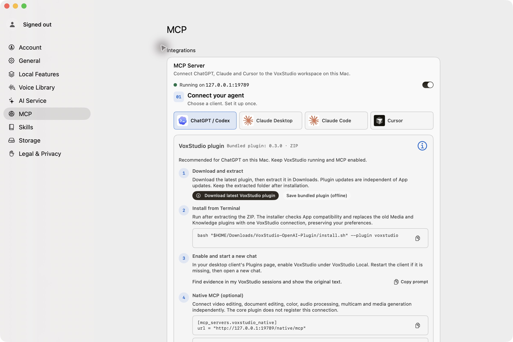

# Codex + VoxStudio: AI video editing demo

A reproducible walkthrough for using Codex with VoxStudio for Mac’s **Native MCP** to find moments in a long source video, assemble a new timeline, add captions, review them, and export.

The app screenshot documents the verified local connection setup. It does not show the NASA edit itself; no NASA frame or video is redistributed in this repository.

> **Tested locally:** VoxStudio for Mac 7.0.49 (139), Native MCP, and H.264 export. The demo source is NASA’s public Artemis II–ISS video. The source MP4 and NASA frames are not included here; the output stayed in local temporary storage.

## What the demo does

- Uses a new VoxStudio project and a new 30 fps timeline.
- Keeps the imported NASA source clip unchanged.
- Places five selected moments in sequence with linked audio.
- Generates English captions, corrects recognition errors, inspects the timeline preview, and exports an H.264 MP4.
- Uses no NASA footage as a repository asset. The README uses an official VoxStudio product image instead.

## Source video

Download the medium MP4 from NASA’s [Image and Video Library page](https://images.nasa.gov/details/jsc2026m000083_ArtemisIIandSpaceStationExpedition74AstronautsCallinSpace):

**Artemis II and Space Station Expedition 74 Astronauts Call in Space**

NASA ID: **jsc2026m000083** · Source duration: 10:35 · Source format used: 1080 × 608, 30 fps

NASA credit for any reproduced excerpt: **Credit: NASA**. NASA does not endorse VoxStudio or this guide. The footage contains identifiable people; before using NASA footage in promotional or commercial material, review NASA’s current [Images and Media Usage Guidelines](https://www.nasa.gov/nasa-brand-center/images-and-media/) and any third-party rights notices. This repository does not redistribute the demo MP4 or a frame from it.

## Connect Codex to the Mac editor

1. Install and open VoxStudio for Mac. In **Settings → MCP**, enable the MCP server and keep VoxStudio running.
2. In Codex, follow the current app instructions under **Settings → MCP → ChatGPT / Codex** for the VoxStudio core plugin.
3. Add Native MCP as a **separate** server. The checked Mac settings screen displayed:

       [mcp_servers.voxstudio_native]
       url = "http://127.0.0.1:19789/native/mcp"

   Codex’s CLI can also register an HTTP MCP server:

       codex mcp add voxstudio_native --url http://127.0.0.1:19789/native/mcp
       codex mcp list

4. Start a new Codex chat and confirm VoxStudio Native tools are available. The core plugin at /chatgpt/mcp does not register the Native editing connection.

The loopback URL only works when Codex and VoxStudio run on the same Mac. For knowledge search and cited recording evidence, see the [MCP Media Guide](https://github.com/metaswang/voxstudio-mcp-media-guide).

## Reproduce the edit

Use the prompts in [PROMPTS.md](PROMPTS.md). First ask Codex to locate and cite candidate source moments without editing. Review the ranges. Then direct it to create a new project/timeline, preserve the original clip, add the chosen source ranges, generate captions, correct the transcript against the original audio, and export.

### Source ranges in the verified timeline

| Order | Source in/out | Duration |
| --- | --- | ---: |
| 1 | 00:53.92–01:03.52 | 9.60 s |
| 2 | 02:34.87–02:50.07 | 15.20 s |
| 3 | 07:31.82–07:38.14 | 6.32 s |
| 4 | 08:55.91–09:01.35 | 5.44 s |
| 5 | 10:19.84–10:24.64 | 4.80 s |
| **Total** | 5 selected moments | **41.37 s** |

The ranges are source-media timecodes, not output timeline positions. Ask Native MCP to inspect the current project and source duration instead of reusing IDs from another session.

### Verified export

| Setting | Result |
| --- | --- |
| Codec | H.264 video with AAC audio |
| Resolution | 1080 × 608 (match timeline) |
| Frame rate | 30 fps |
| Duration | 41.37 s |
| Captions | English captions generated; preview inspected and recognition errors corrected |
| Output | Export completed and opened in QuickTime Player; the MP4 was kept locally and is not included in this repository |

A single preview frame at 00:06 was inspected in VoxStudio. All captions should still be checked against the source audio before publishing an edit.

## Reproducibility notes

- The Mac app version used was **7.0.49 (139)**; the bundled core plugin was **0.3.0**. Checked on **2026-11-08**.
- The original imported media was 10:35, 1080 × 608, 30 fps. The new timeline was 30 fps and 1080 × 608.
- The checked Native MCP result contained 5 source clips and 5 caption groups, totaling 1,241 frames.
- Cloud MCP does not edit a Mac timeline. Keep the core plugin and Native editing MCP as separate client connections.
- This is an example, not a claim that every client/version exposes the same tools. Check **VoxStudio Settings → MCP** and the client’s current MCP status before editing.

## Official references

- [Cut clips from a long video without listening to it again](https://voxstudio.me/blog/make-a-short-video-with-an-ai-assistant)
- [Search Cloud recordings with ChatGPT and check the source](https://voxstudio.me/blog/search-cloud-recordings-with-chatgpt)
- [VoxStudio for Mac](https://voxstudio.me/mac)
- [VoxStudio Web](https://voxstudio.me/)
- [Codex MCP setup](https://developers.openai.com/learn/docs-mcp)
- [NASA source video](https://images.nasa.gov/details/jsc2026m000083_ArtemisIIandSpaceStationExpedition74AstronautsCallinSpace)
- [NASA Images and Media Usage Guidelines](https://www.nasa.gov/nasa-brand-center/images-and-media/)

## License and media

Original documentation and prompts in this repository are licensed under [CC BY 4.0](LICENSE). This license does not cover VoxStudio screenshots or imagery, NASA footage, NASA marks, or any other third-party materials. See [MEDIA-CREDITS.md](MEDIA-CREDITS.md).

## 简体中文摘要

本演示用 Codex 连接 VoxStudio Mac Native MCP，从 NASA Artemis II 与国际空间站公开长视频中选取五段，在新项目和新时间线上加入英文字幕，人工修正识别错误并完成 H.264 导出。原始视频与导出文件不随仓库发布；如另行发布 NASA 片段，应标注 “Credit: NASA”，并先核对 NASA 对商业使用、可识别人物和第三方素材的最新规定。
